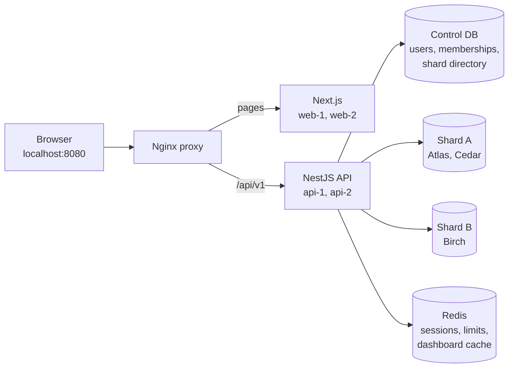

# Team Request & Approval Portal

A local multi-tenant SaaS learning project: employees submit equipment/software requests, reviewers approve or reject, and organization admins manage accounts.

**Current status: MVP complete (M0–M8), plus M9 usability (people, projects, redesigned dashboard).** Sign in at http://localhost:8080, submit requests, browse them with filters and paging, and see dashboard counts (cached in Redis for up to 5 seconds per company and person). Managers and admins approve or reject other people's requests (a rejection needs a comment); admins see the company audit history under Audit and manage accounts under Users (create with a temporary password, change roles, enable/disable; the last active admin is protected). Each signed-in person may make 120 API calls per minute across all API copies. The production build runs as two web and two API copies behind one proxy, and `pnpm demo:verify` checks it. Progress and evidence live in [plan.md](plan.md), [session_state.md](session_state.md), and [docs/demo.md](docs/demo.md).

## How it fits together

The app processes keep nothing per user in memory: any copy can serve any request, because sessions, limits and the cache are in Redis and all data is in Postgres. Each company's requests live on exactly one shard, chosen through the directory in the control database; row-level security inside each shard keeps companies that share a shard apart. Details: [docs/architecture.md](docs/architecture.md).

## Selected stack and requirements

Next.js App Router + NestJS + PostgreSQL + Prisma + Redis.

- Organization-scoped ADMIN, MANAGER, EMPLOYEE roles.
- NestJS-managed local user pool, cookie sessions, password change, and RBAC.
- One central identity/directory database plus two tenant data shards.
- Shared Redis sessions, rate limits, and scoped dashboard cache.
- Transactional audit, pagination, tenant isolation, and stateless application processes.
- Local runtime with no hosted authentication/database/cache/email service.
- Architecture, tests, incremental Git history, and mentor demo evidence.

Exact versions and the reasons for them are in [ADR-010](docs/decisions.md).

## Document map

| File | Owns |
| --- | --- |
| [plan.md](plan.md) | Scope, business rules, milestone acceptance, definition of done |
| [CLAUDE.md](CLAUDE.md) | Persistent instructions for Claude Code |
| [docs/architecture.md](docs/architecture.md) | System, data, auth, routing, transaction, and cache design |
| [docs/decisions.md](docs/decisions.md) | Decisions and explicit assumptions |
| [session_state.md](session_state.md) | Current handoff and verified progress |
| [docs/demo.md](docs/demo.md) | Mentor walkthrough and evidence checklist |
| [docs/learning.md](docs/learning.md) | Plain-language concept notes for the learner |
| [docs/prompts.md](docs/prompts.md) | Reusable Claude Code prompts for milestones, resume, handoff, review |
| [docs/references.md](docs/references.md) | Primary technical references |

## Setup (Windows PowerShell + Docker Desktop)

Prerequisites (verified with these versions):

| Tool | Version | Install |
| --- | --- | --- |
| Node.js | 24.x (>= 24.15) | nodejs.org LTS installer or nvm-windows |
| pnpm | 12.13.0 | `npm install --global pnpm@12.13.0` |
| Docker Desktop | Engine 29+, Compose v2 | WSL2 backend; must be running |
| Git | any recent | |

First run, from the repository root:

~~~powershell
pnpm install          # dependencies from the committed lockfile
pnpm local:setup      # checks prerequisites; creates .env with random local secrets (safe to re-run)
pnpm infra:up         # starts 3x Postgres, Redis, Nginx and waits until healthy
pnpm db:migrate:all   # applies control migrations + the same tenant history to both shards
pnpm db:seed          # 3 demo companies, 4 users each, 64 requests each (safe to re-run)
pnpm db:verify        # read-only checks: shard histories, RLS, roles, data placement
pnpm dev              # Next.js on 127.0.0.1:3000 + NestJS on 127.0.0.1:3001
~~~

Open http://localhost:8080. Admins have a System status page (in the navigation) showing API readiness for the control database, both shards, Redis, and migrations. Always use port 8080 (the proxy), not 3000/3001, so pages and `/api/v1` share one origin.

Daily commands:

| Command | What it does |
| --- | --- |
| `pnpm infra:up` / `pnpm infra:down` | Start / stop containers. Data volumes are kept |
| `pnpm dev` | Development servers with hot reload (Ctrl+C to stop) |
| `pnpm db:migrate:all` | Apply committed migrations to control, shard A, shard B (stops on first failure) |
| `pnpm db:seed` / `pnpm db:verify` | Idempotent demo data / read-only database evidence |
| `pnpm db:generate` | Regenerate the two Prisma clients after a schema change |
| `pnpm verify` | Format check, lint, typecheck, unit tests. Run before every commit |
| `pnpm test:integration` | Database isolation tests (in separate `*_test` databases) and API tests against real Postgres/Redis (needs `infra:up`) |
| `pnpm test:e2e` | Browser tests (Playwright/Chromium) against the running app on :8080; first time: `pnpm exec playwright install chromium` |
| `pnpm build` | Production build of contracts, API, and web |
| `pnpm demo:up` / `pnpm demo:down` | Production images: 2x API + 2x web behind the proxy, and back to dev mode |
| `pnpm demo:verify` | Non-destructive checks of the running replica demo, then `db:verify` (see below) |
| `pnpm secrets:scan` | Scan Git history for committed secrets (local gitleaks container) |
| `pnpm format` | Apply Prettier formatting |

### Replica demo (production build)

Stop `pnpm dev` first (Ctrl+C), then:

~~~powershell
pnpm demo:up       # builds the images, starts api-1, api-2, web-1, web-2, switches the proxy
pnpm demo:verify   # readiness, both replicas, one session on both, CSRF/origin, cache, scope, shared limit, db:verify
pnpm test:e2e      # the browser tests also run against the replicas
pnpm demo:down     # back to dev mode (data volumes are kept)
~~~

In demo mode every API response carries `X-Instance-ID: api-1|api-2` and Nginx adds `X-Upstream` (which container answered). `demo:verify` signs in `manager@cedar.example` and `employee@cedar.example` once each and ends by using up the employee's 120 calls for the current minute, so run it at most twice in 15 minutes.

To watch a replica fail and recover: `docker stop trp-api-1-1`, keep using the app (api-2 answers; the first request after the stop may fail once while the proxy notices), then `docker start trp-api-1-1`. The same session keeps working on both. The same works for `trp-web-1-1`.

Demo accounts: `pnpm db:seed` writes random passwords for `admin|manager|manager2|employee|employee2@<atlas|cedar|birch>.example` to `.local/demo-credentials.json` (Git-ignored). Use them on the sign-in page. Each company has two projects, each with its own manager (`manager` and `manager2`); each employee is on one project, so their manager is that project's manager. Seeded people have realistic names and designations (for example Atlas: Meera Kapoor, Head of Operations). Five sign-in attempts on one account within 15 minutes (right or wrong) block further attempts until the window ends (Retry-After tells you how long); after a wrong password the form shows how many attempts are left. Each `pnpm test:e2e` run signs some accounts in several times, so wait 15 minutes between back-to-back runs.

Health endpoints: `GET /api/v1/health/live` (process alive) and `GET /api/v1/health/ready` (200 when all dependencies answer and every committed migration is applied, otherwise 503 listing which check failed; no hostnames or errors exposed). After pulling new migrations, run `pnpm db:migrate:all`, or readiness reports `migrations: down`.

### Local ports

All bound to 127.0.0.1, never to the network.

| Port | Service |
| --- | --- |
| 8080 | Nginx: the app |
| 3000 / 3001 | Next.js / NestJS dev servers |
| 5433 / 5434 / 5435 | Postgres control / shard A / shard B (databases `trp_control`, `trp_shard_a`, `trp_shard_b`, plus `*_test` copies for integration tests) |
| 6380 | Redis |

### Troubleshooting

- **502 on localhost:8080**: `pnpm dev` is not running (dev mode), or run `pnpm demo:down` if you left demo mode. If `pnpm infra:up` ran before 2026-10-27, restart the proxy once (`docker compose --env-file .env -f infra/compose.yaml restart proxy`) so it loads the current `dev.conf`.
- **Port already in use**: another local Postgres/Redis or an old dev server. On Windows, stopping a terminal can leave `node` running: `Get-NetTCPConnection -LocalPort 3000,3001 -State Listen` shows the owning process.
- **`infra:up` says "run pnpm local:setup first"**: `.env` is missing values.
- **Database roles**: `infra/postgres/init/01-roles.sh` runs only when a volume is first created. Changing passwords in `.env` afterwards does not change existing roles.
- **`The system cannot find the path specified (os error 3)` from pnpm**: the checkout path is too deep for Windows' 260-character limit. Clone to a short path such as `C:\dev\team-request-portal`, or enable Windows long paths.
- **readiness 503**: the JSON names the failing dependency; check `pnpm infra:ps`. `migrations: down` means a database lacks a committed migration: run `pnpm db:migrate:all`.
- **429 Too many attempts / requests**: the login limit is 5 per account per 15 minutes; the API limit is 120 calls per person per minute. Wait for `Retry-After`, or use another demo account.
- **Browser tests flaky against `pnpm dev`**: the dev server compiles pages on demand and can stall. Run them against the production replicas (`pnpm demo:up`) for a reliable result.

## Local data and credentials

Use synthetic data only. Secrets and database passwords are generated by `pnpm local:setup` into the Git-ignored `.env`; `.env.example` holds placeholders only. Never commit real environment values, generated credentials, Docker volumes, database dumps, or personal information.

Normal stopping must retain database volumes. There is no default destructive reset.

## Known design limits

- One organization per account; no invitations, public sign-up, or email.
- A fixed two-shard directory: no automatic rebalancing, no cross-shard joins, and no distributed transactions (account audit lives in control, request audit in the company's shard).
- Dashboard counts may lag by up to 5 seconds during races; request details and every permission check always read the database.
- One local machine: Postgres and Redis are single instances without replication or backups. Losing Redis signs everyone out and returns 503 for protected work until it is back.
- Stopping a replica can make one in-flight request fail before the proxy notices; there is no promise of zero downtime.
- Not production-hardened: no TLS (plain HTTP is allowed only on localhost), Argon2 parameters are the OWASP baseline but not benchmarked on this machine, and local inspection ports are open on 127.0.0.1.

The user-pool interpretation is recorded as assumption A-01 in plan.md for mentor review.

Inspection ports and the Redis password on the container command line are local-development conveniences, not production settings.

