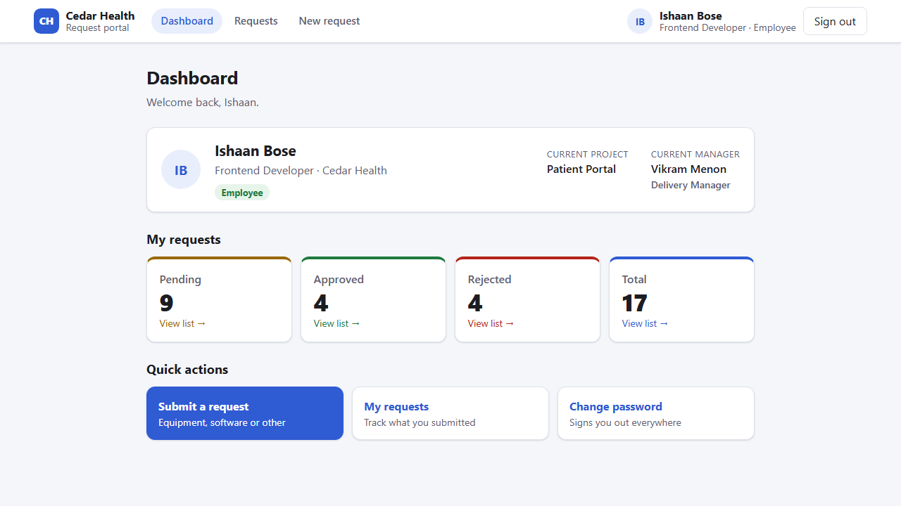
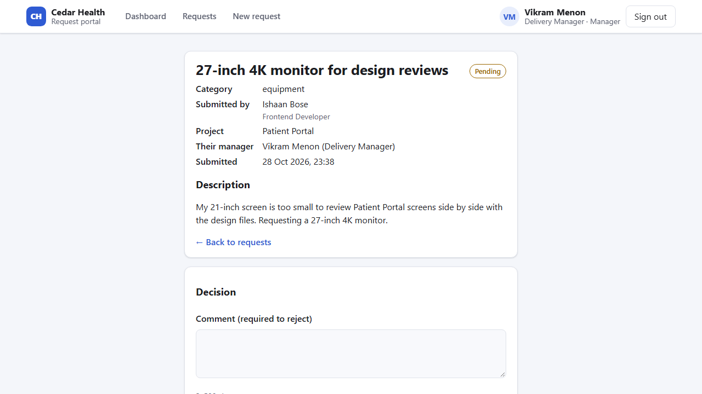
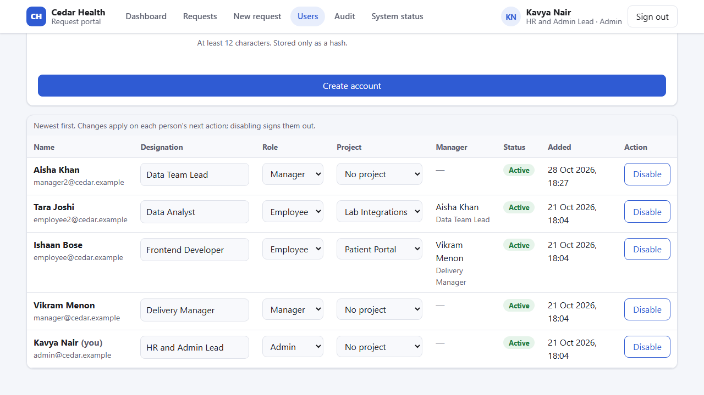
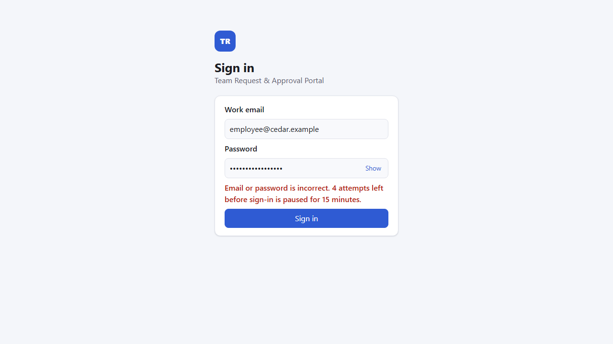
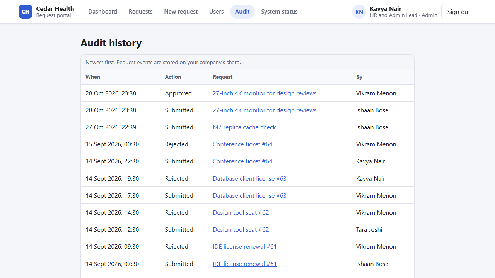
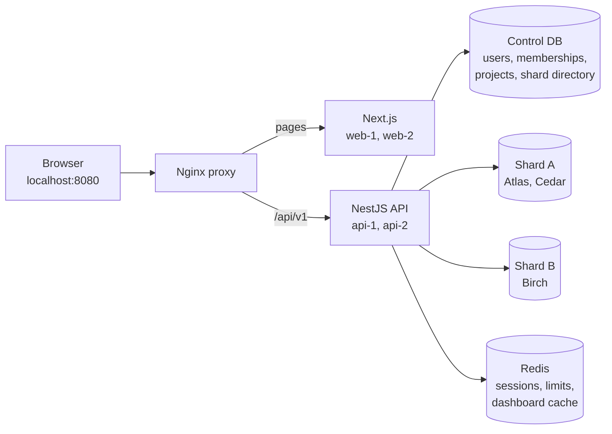

# Team Request & Approval Portal

**One secure place where employees ask for what they need, managers decide, and every decision is on record, for many companies at once.**

A multi-tenant SaaS application: Next.js · NestJS · PostgreSQL (three databases, two of them tenant shards) · Prisma · Redis · Nginx. TypeScript strict throughout. **143 automated tests**, all run against real Postgres and Redis.

## The problem

In most teams, requests for a laptop, a monitor, a software licence, or system access are scattered across email, chat, and spreadsheets.

- **Requests get lost.** Nobody knows the status, so people chase approvers by message.
- **No control.** Anyone can "approve", including their own request, and two people can decide the same request differently.
- **No audit trail.** When finance, security, or an auditor asks who approved what and when, nobody has a reliable answer.
- **No context.** An approver can't see who the requester works with, which project they are on, or who their manager is.

A SaaS vendor that offers this as a product has one more hard problem: **every customer company's data must stay strictly separate**, even when they share the same servers and databases, and the product must keep working as it scales out.

## The solution

The portal gives every company its own secure workspace with three roles:

| Role | What they can do |
| --- | --- |
| **Employee** | Submit requests (equipment, software, other) and track their own; see their designation, project, and manager |
| **Manager** | Everything an employee can, plus review all company requests and approve or reject them with a comment (never their own) |
| **Admin** | Everything a manager can, plus manage people (create accounts, roles, enable/disable, designation, project), read the full audit history, and see system status |

### Key features

- **Request workflow:** submit, track, filter by status and category, cursor pagination, approve or reject with a required rejection comment.
- **One decision, always:** two managers clicking at the same moment produce exactly one decision. The other gets a clear "already decided" message.
- **Complete audit trail:** every submission and decision is written in the same database transaction as the change itself.
- **People and projects:** each company has projects with their own managers. Everyone sees their designation, current project, and current manager.
- **Secure accounts:**
  - Argon2id passwords and HttpOnly session cookies with CSRF protection.
  - Forced password change for new accounts.
  - Show/hide password toggle and "attempts left" after a wrong password.
  - Sign-in limits.
- **Admin safety:** role and disable changes apply on the user's very next click. A company can never lose its last active admin, even when two admins act at the same moment.
- **Role-based dashboard:** profile card, live counts (cached in Redis for at most 5 seconds), and quick actions per role.
- **Built to scale:** the app runs as two web and two API copies behind one proxy. Stop one and users stay signed in.

## Screenshots

| Manager reviews a request | Admin manages people and projects |
| --- | --- |
|  |  |
| **Sign-in with attempts left** | **Audit history** |
|  |  |

## How it fits together

1. The browser talks to one origin. Nginx sends `/api/v1` to NestJS and everything else to Next.js.
2. NestJS owns every rule and every write. Next.js only renders pages and calls the API.
3. On every request, the API loads the signed-in user's current membership and role from the control database. It looks up the company's shard in the directory, then runs the work in a tenant-scoped transaction on that shard.
4. Inside each shard, PostgreSQL row-level security hides other companies' rows, even if a query forgot its filter.
5. Sessions, rate limits, and the dashboard cache live in Redis, so the app processes keep no per-user state and any copy can serve any request.

Full design: [docs/architecture.md](docs/architecture.md). Decisions and their reasons: [docs/decisions.md](docs/decisions.md) (21 ADRs).

## Engineering highlights

| Concern | How it is solved | Proof |
| --- | --- | --- |
| Tenant isolation | Tenant context built only from the signed-in membership; explicit `tenant_id` filter in every query; **forced RLS** with a non-superuser runtime role; composite same-company foreign keys | Atlas cannot read Cedar (same shard) or Birch (other shard); with the app filter removed, RLS still isolated; `db:verify` |
| Horizontal sharding | Directory-based routing: Atlas and Cedar on shard A, Birch on shard B; one migration history applied to both | `db:verify` shows each company's rows only on its own shard |
| Concurrency | Decisions: conditional `UPDATE ... WHERE status = 'PENDING' AND version = n`. Admin changes: organization row lock | 10 races per run: always one 200, one 409, one audit event; never zero admins |
| Atomic audit | Change and audit event in one transaction (request audit on the shard, account audit in control) | A forced audit failure rolls the change back |
| Authentication | Argon2id; Redis sessions rotated at login; CSRF token plus exact Origin check; idle and absolute expiry; `sessionVersion` revocation | Fixation, CSRF, expiry, revocation, and shared-limit tests |
| Current authorization | Role and active status re-read on every request, never cached | A demoted manager gets 403 on the next call, on any API copy |
| Stateless scaling | Two web and two API replicas; Redis-backed sessions and limits | Stop api-1: every call answered by api-2 with the same session |
| Failure behaviour | Cache down: fall back to the database. Session store or limiter down: 503 (fail closed) | Integration tests break Redis on purpose |
| Supply chain | Exact versions, 7-day release-age rule, install-script allowlist, `pnpm audit`, gitleaks secret scan | Clean audit and secret scan at every merge |

## Quality evidence

| Check | Latest result |
| --- | --- |
| `pnpm verify` (format, lint, typecheck, unit tests) | clean; 28 unit tests (2026-10-28) |
| `pnpm test:integration` (real Postgres and Redis) | 16 database + 93 API = 109 passed (2026-10-28) |
| `pnpm test:e2e` (Playwright) | 6/6 against `pnpm dev` (2026-10-28) and against the two-replica production build (2026-10-27) |
| `pnpm db:verify` | all checks passed (2026-10-28): identical shard migrations, forced RLS, safe roles, correct data placement |
| `pnpm demo:verify` (replicas) | all checks passed (2026-10-27): one session on both API copies, shared rate limit, CSRF, cache, scope |
| Fresh clone from GitHub before each merge | M8: install, verify, build, audit, integration, migrate, seed twice, E2E, `demo:verify`; M9: install, verify, build, audit, integration, migrate, `db:verify`: all passed |
| `pnpm secrets:scan` | no leaks in the full Git history |

Test layers, mutation checks, and the bugs they caught: [docs/ai-workflow.md](docs/ai-workflow.md#5-ai-assisted-qa).

## Built with AI

The project was built milestone by milestone with **Claude Code** as a pair engineer. Short project rules (CLAUDE.md), a plan with acceptance gates (plan.md), ADRs, and a handoff file (session_state.md) carried the context between sessions. Nothing was marked done without real command output. The context engineering, guardrails, human review, and AI-assisted QA are described in [docs/ai-workflow.md](docs/ai-workflow.md).

## Future scope

This is the MVP. Planned next:
- Project-based approval routing and multi-step approval chains with budgets.
- Email, Slack, and Teams notifications.
- Single sign-on and multi-factor authentication.
- Analytics.
- A private, self-hosted AI assistant: smart intake, duplicate detection, policy checks, and approver briefs.
- Online tenant moves between shards, replicas, and backups.

See [docs/roadmap.md](docs/roadmap.md).

## Tech stack

| Layer | Choice |
| --- | --- |
| Frontend | Next.js 16 (App Router), React 19, TypeScript |
| Backend | NestJS 12 modular monolith, zod contracts shared with the web app |
| Data | PostgreSQL 18 (control database plus two tenant shards), Prisma ORM 7, row-level security |
| State and cache | Redis 8 (sessions, rate limits, dashboard cache) |
| Edge | Nginx (same-origin reverse proxy, two replicas of each app) |
| Quality | Vitest, Supertest, Playwright, ESLint, Prettier, gitleaks, pnpm workspace |

Exact pinned versions and why each was chosen: [ADR-010](docs/decisions.md). The runtime needs no hosted service: identity, data, and cache all run locally.

## Document map

| File | Owns |
| --- | --- |
| [plan.md](plan.md) | Scope, business rules, milestones (M0–M9) with acceptance evidence, definition of done |
| [docs/architecture.md](docs/architecture.md) | System, data, auth, routing, transaction, and cache design |
| [docs/decisions.md](docs/decisions.md) | Architecture decision records and assumptions |
| [docs/roadmap.md](docs/roadmap.md) | Future scope beyond the MVP |
| [docs/ai-workflow.md](docs/ai-workflow.md) | How AI was used: context, guardrails, review, QA |
| [docs/demo.md](docs/demo.md) | Demo walkthrough and evidence record |
| [docs/learning.md](docs/learning.md) | Plain-language notes on every backend concept used |
| [docs/prompts.md](docs/prompts.md) | Reusable Claude Code prompts |
| [docs/references.md](docs/references.md) | Primary technical references |
| [CLAUDE.md](CLAUDE.md) / [session_state.md](session_state.md) | AI project instructions / current handoff |

## Run it locally (Windows PowerShell + Docker Desktop)

Prerequisites (verified with these versions):

| Tool | Version | Install |
| --- | --- | --- |
| Node.js | 24.x (>= 24.15) | nodejs.org LTS installer or nvm-windows |
| pnpm | 12.13.0 | `npm install --global pnpm@12.13.0` |
| Docker Desktop | Engine 29+, Compose v2 | WSL2 backend; must be running |
| Git | any recent | |

First run, from the repository root:

~~~powershell
pnpm install          # dependencies from the committed lockfile
pnpm local:setup      # checks prerequisites; creates .env with random local secrets (safe to re-run)
pnpm infra:up         # starts 3x Postgres, Redis, Nginx and waits until healthy
pnpm db:migrate:all   # applies control migrations + the same tenant history to both shards
pnpm db:seed          # 3 demo companies, 4 users each, 64 requests each (safe to re-run)
pnpm db:verify        # read-only checks: shard histories, RLS, roles, data placement
pnpm dev              # Next.js on 127.0.0.1:3000 + NestJS on 127.0.0.1:3001
~~~

Open http://localhost:8080. Admins have a System status page (in the navigation) showing API readiness for the control database, both shards, Redis, and migrations. Always use port 8080 (the proxy), not 3000/3001, so pages and `/api/v1` share one origin.

Daily commands:

| Command | What it does |
| --- | --- |
| `pnpm infra:up` / `pnpm infra:down` | Start / stop containers. Data volumes are kept |
| `pnpm dev` | Development servers with hot reload (Ctrl+C to stop) |
| `pnpm db:migrate:all` | Apply committed migrations to control, shard A, shard B (stops on first failure) |
| `pnpm db:seed` / `pnpm db:verify` | Idempotent demo data / read-only database evidence |
| `pnpm db:generate` | Regenerate the two Prisma clients after a schema change |
| `pnpm verify` | Format check, lint, typecheck, unit tests. Run before every commit |
| `pnpm test:integration` | Database isolation tests (in separate `*_test` databases) and API tests against real Postgres/Redis (needs `infra:up`) |
| `pnpm test:e2e` | Browser tests (Playwright/Chromium) against the running app on :8080; first time: `pnpm exec playwright install chromium` |
| `pnpm build` | Production build of contracts, API, and web |
| `pnpm demo:up` / `pnpm demo:down` | Production images: 2x API + 2x web behind the proxy, and back to dev mode |
| `pnpm demo:verify` | Non-destructive checks of the running replica demo, then `db:verify` (see below) |
| `pnpm secrets:scan` | Scan Git history for committed secrets (local gitleaks container) |
| `pnpm format` | Apply Prettier formatting |

### Replica demo (production build)

Stop `pnpm dev` first (Ctrl+C), then:

~~~powershell
pnpm demo:up       # builds the images, starts api-1, api-2, web-1, web-2, switches the proxy
pnpm demo:verify   # readiness, both replicas, one session on both, CSRF/origin, cache, scope, shared limit, db:verify
pnpm test:e2e      # the browser tests also run against the replicas
pnpm demo:down     # back to dev mode (data volumes are kept)
~~~

In demo mode every API response carries `X-Instance-ID: api-1|api-2` and Nginx adds `X-Upstream` (which container answered). `demo:verify` signs in `manager@cedar.example` and `employee@cedar.example` once each and ends by using up the employee's 120 calls for the current minute, so run it at most twice in 15 minutes.

To watch a replica fail and recover: `docker stop trp-api-1-1`, keep using the app (api-2 answers; the first request after the stop may fail once while the proxy notices), then `docker start trp-api-1-1`. The same session keeps working on both. The same works for `trp-web-1-1`.

Demo accounts: `pnpm db:seed` writes random passwords for `admin|manager|manager2|employee|employee2@<atlas|cedar|birch>.example` to `.local/demo-credentials.json` (Git-ignored). Use them on the sign-in page. Each company has two projects, each with its own manager (`manager` and `manager2`); each employee is on one project, so their manager is that project's manager. Seeded people have realistic names and designations (for example Atlas: Meera Kapoor, Head of Operations). Five sign-in attempts on one account within 15 minutes (right or wrong) block further attempts until the window ends (Retry-After tells you how long); after a wrong password the form shows how many attempts are left. Each `pnpm test:e2e` run signs some accounts in several times, so wait 15 minutes between back-to-back runs.

Health endpoints: `GET /api/v1/health/live` (process alive) and `GET /api/v1/health/ready` (200 when all dependencies answer and every committed migration is applied, otherwise 503 listing which check failed; no hostnames or errors exposed). After pulling new migrations, run `pnpm db:migrate:all`, or readiness reports `migrations: down`.

### Local ports

All bound to 127.0.0.1, never to the network.

| Port | Service |
| --- | --- |
| 8080 | Nginx: the app |
| 3000 / 3001 | Next.js / NestJS dev servers |
| 5433 / 5434 / 5435 | Postgres control / shard A / shard B (databases `trp_control`, `trp_shard_a`, `trp_shard_b`, plus `*_test` copies for integration tests) |
| 6380 | Redis |

### Troubleshooting

- **502 on localhost:8080**: `pnpm dev` is not running (dev mode), or run `pnpm demo:down` if you left demo mode. If `pnpm infra:up` ran before 2026-10-27, restart the proxy once (`docker compose --env-file .env -f infra/compose.yaml restart proxy`) so it loads the current `dev.conf`.
- **Port already in use**: another local Postgres/Redis or an old dev server. On Windows, stopping a terminal can leave `node` running: `Get-NetTCPConnection -LocalPort 3000,3001 -State Listen` shows the owning process.
- **`infra:up` says "run pnpm local:setup first"**: `.env` is missing values.
- **Database roles**: `infra/postgres/init/01-roles.sh` runs only when a volume is first created. Changing passwords in `.env` afterwards does not change existing roles.
- **`The system cannot find the path specified (os error 3)` from pnpm**: the checkout path is too deep for Windows' 260-character limit. Clone to a short path such as `C:\dev\team-request-portal`, or enable Windows long paths.
- **readiness 503**: the JSON names the failing dependency; check `pnpm infra:ps`. `migrations: down` means a database lacks a committed migration: run `pnpm db:migrate:all`.
- **429 Too many attempts / requests**: the login limit is 5 per account per 15 minutes; the API limit is 120 calls per person per minute. Wait for `Retry-After`, or use another demo account.
- **Browser tests flaky against `pnpm dev`**: the dev server compiles pages on demand and can stall. Run them against the production replicas (`pnpm demo:up`) for a reliable result.

## Local data and credentials

Use synthetic data only. Secrets and database passwords are generated by `pnpm local:setup` into the Git-ignored `.env`; `.env.example` holds placeholders only. Never commit real environment values, generated credentials, Docker volumes, database dumps, or personal information.

Normal stopping must retain database volumes. There is no default destructive reset.

## Known design limits

- One organization per account; no invitations, public sign-up, or email.
- A fixed two-shard directory: no automatic rebalancing, no cross-shard joins, and no distributed transactions (account audit lives in control, request audit in the company's shard).
- Dashboard counts may lag by up to 5 seconds during races; request details and every permission check always read the database.
- One local machine: Postgres and Redis are single instances without replication or backups. Losing Redis signs everyone out and returns 503 for protected work until it is back.
- Stopping a replica can make one in-flight request fail before the proxy notices; there is no promise of zero downtime.
- Not production-hardened: no TLS (plain HTTP is allowed only on localhost), Argon2 parameters are the OWASP baseline but not benchmarked on this machine, and local inspection ports are open on 127.0.0.1.

The "user pool" requirement is met by an identity store inside the NestJS API (assumption A-01 in plan.md); external single sign-on is future scope.

Inspection ports and the Redis password on the container command line are local-development conveniences, not production settings.

